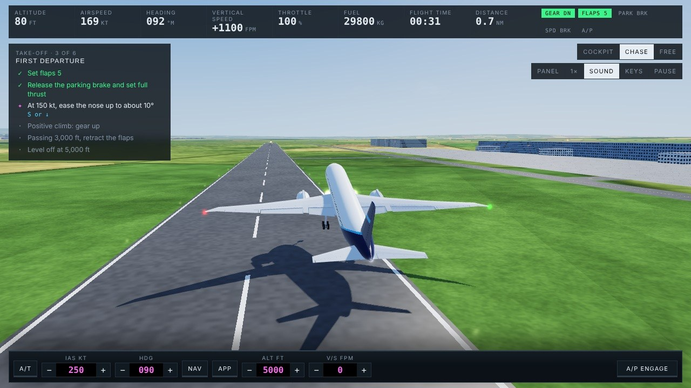
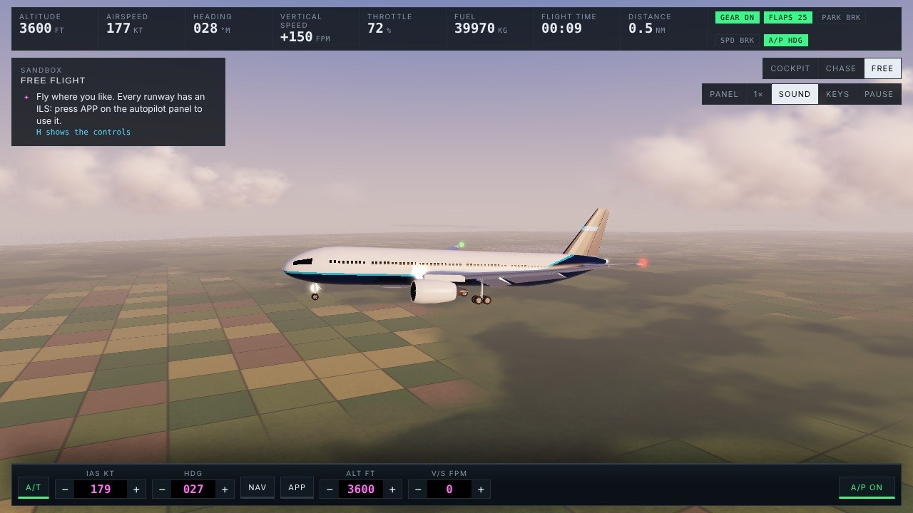
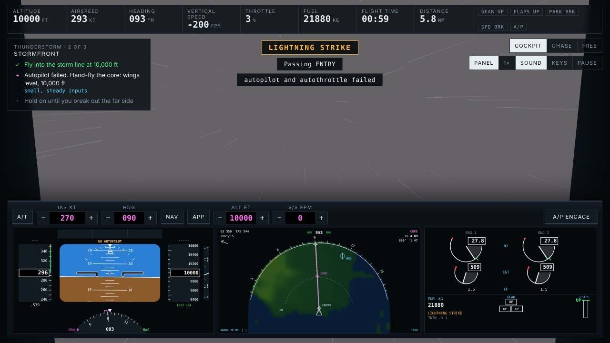
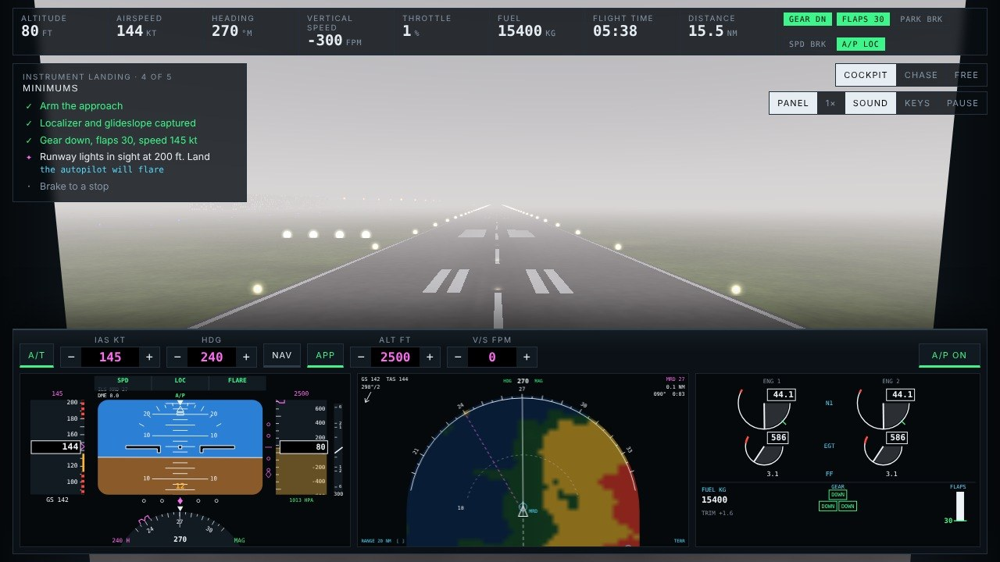

# Meridian Flight Deck

A miniature airliner simulator that runs in a browser tab. One HTML file, no libraries, no build tools, no API keys: the 3D engine, the flight physics, the cockpit instruments and the sound are all written from scratch in plain JavaScript and WebGL 2.

[Watch the full 40-second clip (MP4, 1280×720)](media/demo.mp4)

| | |
|---|---|
|  |  |
|  |  |

## Play

Open `index.html` in a recent desktop browser (Chrome, Edge, Firefox or Safari with WebGL 2). Nothing needs to be installed or served. The only network request is for three web fonts, and the page works without them.

To host it, turn on GitHub Pages for this repository and it will serve `index.html` as is.

## What is in it

| | |
|---|---|
| **World** | A 128 km island with mountains, sea, farmland, five towns and three airports. Runways have markings, edge and approach lights, PAPI and an ILS at each end. |
| **Sky** | Sunrise, day, sunset and night with stars and moonlight. Six weather presets: clear, scattered cloud, overcast, thunderstorm, fog and gusting crosswind. Rain, lightning, haze that thins with height, and cloud you can fly into. |
| **Aircraft** | A 787-style twin with working flaps, ailerons, spoilers, elevators, rudder, retracting gear, spinning fans and wings that flex with load. It casts a shadow on the ground and on itself. |
| **Physics** | A six-degree-of-freedom rigid body at 120 Hz: lift, drag, thrust and gravity, stall and post-stall behaviour, ground effect, engine spool-up, fuel burn, sprung landing gear with tyre friction and brakes, steady wind, turbulence and storm up- and downdrafts. |
| **Cockpit** | Primary flight display, navigation display with a terrain picture, engine display, and an autopilot panel: autothrottle, heading, altitude, vertical speed, route following and ILS approach with automatic flare. |
| **Cameras** | Cockpit, chase and free orbit, with smooth transitions. |
| **Sound** | Synthesised engines, airflow, ground roll, rain, thunder, warnings and altitude callouts. |

## Missions

1. **First Departure** – take off from Meridian and climb to 5,000 ft.
2. **Golden Hour Crossing** – a 40 NM cross-country to Halcyon Bay, landing at sunset.
3. **Stormfront** – hand-fly through a thunderstorm after a lightning strike takes out the autopilot.
4. **Dead Stick** – an engine failure and a fuel leak leave you gliding to the runway.
5. **Sideways into Halcyon** – land in a 27 kt gusting crosswind.
6. **Minimums** – an ILS approach in fog with the runway in sight only at 200 ft.
7. **Free Flight** – any airport, any weather, any hour.

## Controls

| Key | Action |
|---|---|
| `W` `S` or `↑` `↓` | Pitch. `S` or `↓` pulls the nose up |
| `A` `D` or `←` `→` | Roll |
| `Q` `E` | Rudder and nose-wheel steering |
| `R` `F` or `+` `−` | Throttle up and down |
| `X` `Z` | Flaps: extend, retract |
| `G` | Landing gear |
| `Space` | Wheel brakes (hold) |
| `B` | Parking brake |
| `K` | Speedbrake |
| `P` | Autopilot |
| `T` | Autothrottle |
| `C` or `1` `2` `3` | Camera: cockpit, chase, free |
| `V` | Show or hide the instruments |
| `[` `]` | Map range |
| `N` | Simulation speed: 1×, 2×, 4× |
| Mouse drag | Yoke |
| Right drag, wheel | Look around, zoom |
| `Esc` | Pause, weather, time of day, graphics and sound settings |

### Taking off

1. Press `X` twice for flaps 5.
2. Press `B` to release the parking brake.
3. Hold `R` until the throttle reads 100 %.
4. Keep straight with `Q` and `E`.
5. At 150 kt hold `S` until the nose is about 10° up, then let go.
6. Once climbing, press `G` to raise the gear.

## How it is put together

```
src/core.js      math, terrain generation, atmosphere, flight model, landing gear, autopilot
src/missions.js  mission definitions, objective tracking, landing scoring
src/glx.js       small WebGL 2 toolkit: matrices, shader programs, mesh builder
src/shaders.js   GLSL: sky and ocean, terrain, lit meshes, clouds, lights, rain
src/world.js     GPU geometry for terrain, airports, towns, lights and clouds
src/aircraft.js  the procedural aircraft model and its moving parts
src/render.js    the frame: shadow pass, sky, terrain, aircraft, clouds, weather
src/panel.js     the cockpit displays, drawn on 2D canvases
src/audio.js     synthesised sound
src/app.js       input, cameras, mission flow, HUD, main loop
src/page.html    markup and styles
```

`core.js` and `missions.js` have no browser dependencies, so the physics and the missions can be tested in Node.

## Build and test

```sh
./build.sh                 # bundles src/ into index.html
node test/flight.js        # take-off, autopilot, stall, glide and autoland checks
node test/missions.js      # every mission starts in a sane state
node test/route.js         # flies the whole cross-country mission on autopilot
node test/human.js         # a clumsy keyboard pilot takes off without stalling
node test/map.js           # prints an ASCII map of the island
```

The tests print flight data for inspection; they are not pass/fail assertions.

## Known limits

- Built and checked with software WebGL in headless Chrome. Frame rate on real graphics hardware has not been measured; the page lowers its render resolution automatically if frames run slow, and there is a manual graphics setting in the pause menu.
- Designed for a keyboard and mouse. There are touch buttons, but a phone is not a comfortable way to fly it.
- The aircraft is a 787-style approximation, not a certified model of any real type.
